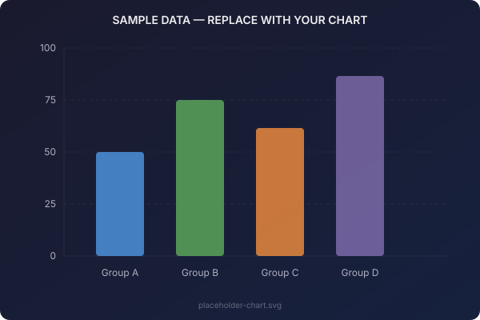

<!-- _class: lead -->

# Introduction to Research Methods

## Foundations of Empirical Inquiry

**Dr. Jane Smith**
Department of Psychology, University Name

Semester 1, 2026

---

# Types of Research

### Quantitative

- Numerical data
- Statistical analysis
- Experiments and surveys

### Qualitative

- Text and interviews
- Depth and context
- Case studies and ethnography

**Mixed methods** combine both approaches to leverage the strengths of each.

---

# Visualising Your Data

Common chart types for research data:

- **Bar charts** — comparing categories
- **Line charts** — trends over time
- **Scatter plots** — relationships between variables
- **Box plots** — distribution and outliers

*Figure 1. Sample data across four experimental groups.*

---

<!-- _class: lead -->

# Questions?

j.smith@university.edu

Slides available at: courses.university.edu/psyc1001

---

<!-- This slide demonstrates Marp's scoped CSS feature.
     A 

# Scoped Styling Demo

- Marp supports `<style scoped>` blocks for per-slide CSS
- Styles defined here apply **only** to this slide
- Other slides keep the default theme styling
- Great for highlighting a single slide without a custom theme

---

<!-- This slide demonstrates Marp's directive comments.
     Directives like _backgroundColor and _color are placed in
     HTML comments and override the theme for the current slide.
     Prefixing with _ makes them "local" (single-slide) directives. -->

<!-- _backgroundColor: #1a1a2e -->
<!-- _color: #f0f0f0 -->

# Directive Demo

- Marp uses **directives** to control slide appearance
- Local directives (prefixed with `_`) apply to one slide only
- Global directives (no prefix) apply from that slide onward
- Common directives: `backgroundColor`, `color`, `class`, `header`, `footer`
