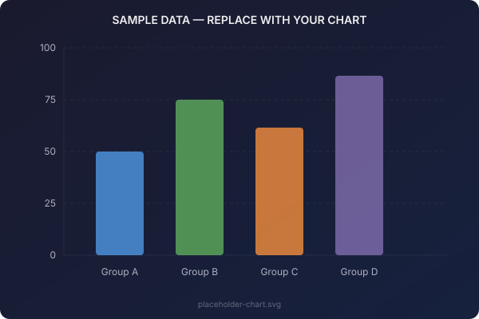

## Types of Research

:::: {.columns}

::: {.column width="50%"}
### Quantitative

- Numerical data
- Statistical analysis
- Experiments and surveys
:::

::: {.column width="50%"}
### Qualitative

- Text and interviews
- Depth and context
- Case studies and ethnography
:::

::::

Many modern studies use **mixed methods**, combining both approaches to leverage their respective strengths.

## Visualising Your Data

:::: {.columns}

::: {.column width="50%"}
Choosing the right chart matters:

- **Bar charts** — compare groups
- **Line charts** — show trends over time
- **Scatter plots** — reveal relationships
- **Box plots** — display distributions
:::

::: {.column width="50%"}

:::

::::

## Questions? {.center}

j.smith@university.edu

Slides available at: courses.university.edu/psyc1001

## Code Execution Demo

```{python}
#| echo: true
#| fig-width: 8
#| fig-height: 4

import matplotlib.pyplot as plt

groups = ["Control", "Low Dose", "Medium Dose", "High Dose"]
values = [12.3, 15.1, 22.7, 28.4]

plt.bar(groups, values, color=["#4C72B0", "#55A868", "#C44E52", "#8172B2"])
plt.xlabel("Group")
plt.ylabel("Mean Score")
plt.title("Treatment Effect by Group")
plt.tight_layout()
plt.show()
```

Quarto can execute **Python**, **R**, **Julia**, and **Observable** code directly in your slides.

## Citations & References

Quarto supports inline citations using BibTeX:

> "Recent work has demonstrated significant effects of the intervention `[@author2024]`."

### Citation Features

- **Footnotes** — add notes with `^[This is a footnote]`
- **Cross-references** — link to figures, tables, and sections with `@fig-label`
- **Bibliographies** — point to a `.bib` file in the YAML frontmatter with `bibliography: references.bib`

Quarto automatically generates a formatted reference list at the end of your document.
