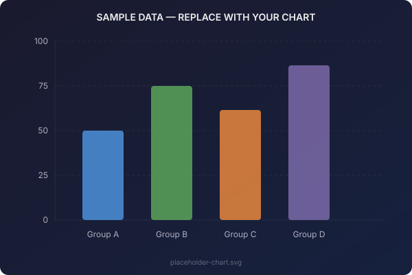

# Introduction to Research Methods

## Foundations of Empirical Inquiry

**Dr. Jane Smith**

Department of Psychology, University Name

Semester 1, 2026

---
layout: two-cols
---

# Types of Research

::left::

### Quantitative

- Numerical data
- Statistical analysis
- Experiments and surveys

**Mixed methods** combine both approaches to leverage the strengths of each.

::right::

### Qualitative

- Text and interviews
- Depth and context
- Case studies and ethnography

---
layout: two-cols
---

# Visualising Your Data

::left::

Common chart types for research data:

- **Bar charts** — comparing categories
- **Line charts** — trends over time
- **Scatter plots** — relationships between variables
- **Box plots** — distribution and outliers

*Figure 1. Sample data across four experimental groups.*

::right::



---
layout: center
---

# Questions?

j.smith@university.edu

Slides available at: courses.university.edu/psyc1001

---

# Code Highlighting

```python {all|1-3|5-8}
import pandas as pd
import matplotlib.pyplot as plt

# Load and summarise experimental data
df = pd.read_csv("results.csv")
summary = df.groupby("group").mean()
summary.plot(kind="bar", ylabel="Score")
plt.show()
```

Slidev highlights lines step-by-step as you click through the slide. The `{all|1-3|5-8}` syntax after the language identifier defines each highlight step: first all lines are shown, then lines 1-3 are focused, then lines 5-8.

---

# Interactive Components

<script setup>
import { ref } from 'vue'
const count = ref(0)
</script>

Clicked: {{ count }} times

<button @click="count++">Click me</button>

Slidev slides can embed Vue components directly, enabling interactivity that no other slide tool supports natively. The counter above is a live reactive component — try clicking the button during the presentation.
